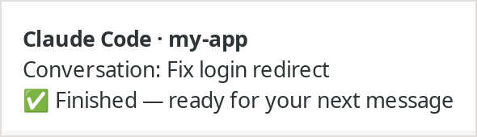
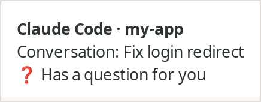
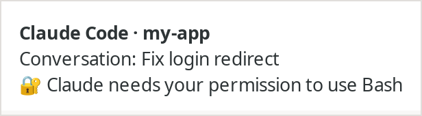
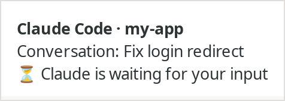

# Claude Code notifications for Linux

Get a desktop notification when Claude Code finishes a response or needs your input. Each notification names the project and the conversation, so you can tell which one needs you when you run several at once.

<p>
  
  
  
  
</p>

<sub>Shown with XFCE's notification server. Other desktops style notifications their own way.</sub>

| | When | Sound |
|---|---|---|
| ✅ | A response finished | complete |
| ❓ | Claude is asking you a question | message-new-instant |
| 🔐 | A tool needs your permission | message-new-instant |
| ⏳ | Claude has been waiting for your input | message-new-instant |

- **No extra installs on a typical desktop.** It needs `python3` and either `notify-send` or `gdbus`, which ship with Ubuntu, Fedora, Debian, Mint, Pop!_OS and most other desktop distributions.
- **Any desktop.** It uses the standard freedesktop notification service, so it works with GNOME, KDE Plasma, XFCE, Cinnamon, MATE, and notification daemons such as dunst and mako.
- **Any terminal or IDE.** It hooks into Claude Code itself, so it works the same in any terminal, VS Code or JetBrains.
- **Tells conversations apart.** Each notification names the project and the conversation title, not just "Claude is done".

> **Status:** tested on Python 3.6 to 3.13 and against a real notification server (dunst) in Docker, but not yet on a physical Linux desktop. If something doesn't work on yours, please [open an issue](https://github.com/kevinam99/claude-code-linux-notifications/issues) with your distribution and desktop.

## Install

In Claude Code:

```
/plugin marketplace add kevinam99/claude-code-linux-notifications
/plugin install linux-notifications@claude-code-linux-notifications
```

There's no setup step. To check that notifications reach your desktop, run this in a terminal, replacing the path with the plugin's folder (`/plugin` shows where it's installed), or from a clone of this repo:

```sh
echo '{"hook_event_name":"Stop","cwd":"'"$PWD"'"}' | python3 scripts/notify.py
```

If nothing appears, check that `notify-send --version` or `gdbus --version` works, and that Do Not Disturb is off.

## Settings

To turn sounds on or off or change them, use the `/linux-notifications:sound` command in Claude Code:

```
/linux-notifications:sound              show the current sounds and the ones available
/linux-notifications:sound off          turn all sounds off
/linux-notifications:sound on           go back to the default sounds
/linux-notifications:sound test         send a test notification with each current sound
/linux-notifications:sound done bell    change the "finished" sound
/linux-notifications:sound input off    turn off only the "needs input" sound
```

The command edits the settings below for you. To set them by hand, add them as environment variables in the `env` section of `~/.claude/settings.json`:

```json
{
  "env": {
    "CLAUDE_NOTIFY_SOUND_DONE": "bell",
    "CLAUDE_NOTIFY_SOUND_INPUT": "dialog-warning",
    "CLAUDE_NOTIFY_ON_DONE": "0"
  }
}
```

| Variable | Default | Effect |
|---|---|---|
| `CLAUDE_NOTIFY_SOUND_DONE` | `complete` | Sound when a response finishes. `none` for silent. |
| `CLAUDE_NOTIFY_SOUND_INPUT` | `message-new-instant` | Sound when input is needed. `none` for silent. |
| `CLAUDE_NOTIFY_ON_DONE` | on | `0` turns off the "finished" notification and keeps the input ones. |

Sound names come from the freedesktop sound theme, in `/usr/share/sounds/freedesktop/stereo`. They include alarm-clock-elapsed, bell, complete, dialog-information, dialog-warning, message, message-new-instant and phone-incoming-call.

### How sounds are played

Not every notification server plays sounds; GNOME's mostly doesn't. So the script plays the sound itself when it can, using `canberra-gtk-play`, `pw-play` (PipeWire) or `paplay` (PulseAudio), and tells the notification server not to play one too. If none of those is available, it asks the notification server to play it, which some servers (such as KDE's) do.

## Manual install (without the plugin system)

Clone the repo somewhere permanent, then add hooks to `~/.claude/settings.json`, merging with any `hooks` you already have. Replace the path with where you cloned it:

```json
{
  "hooks": {
    "Stop": [
      {
        "hooks": [
          { "type": "command", "command": "python3 \"$HOME/claude-code-linux-notifications/scripts/notify.py\"", "async": true }
        ]
      }
    ],
    "Notification": [
      {
        "matcher": "permission_prompt|idle_prompt|elicitation_dialog",
        "hooks": [
          { "type": "command", "command": "python3 \"$HOME/claude-code-linux-notifications/scripts/notify.py\"", "async": true }
        ]
      }
    ]
  }
}
```

## Notes

- **Conversation title.** This comes from the title Claude Code stores in the conversation transcript: a name you set with `/rename`, or the one it generates. The transcript format isn't a documented API; if it changes, notifications still appear, just without the conversation line.
- **Layout.** Linux notifications have a title and a body but no subtitle, so the conversation line is the first line of the body.
- **Questions.** Claude Code reports its own questions as a permission prompt for the `AskUserQuestion` tool. The script recognises that and says "Has a question for you" instead.
- **The "finished" notification fires after every response**, including in the conversation you're looking at. Hooks can't tell which conversation is on screen.
- **No desktop, no notifications.** Over SSH, in a container or in WSL there's no notification service to send to, and the hooks quietly do nothing. WSL isn't supported yet.

## Minimal by design

This plugin deliberately sticks to what a desktop Linux system already has. The tradeoff is that **clicking a notification doesn't take you to the conversation**: that would need a notification sender that waits for the click and something that can switch to the right terminal tab or editor window, neither of which works the same across desktops.

## Uninstall

```
/plugin uninstall linux-notifications@claude-code-linux-notifications
```

## Development

- `tests/run.sh` runs the script in dry-run mode (`CLAUDE_NOTIFY_DRY_RUN=1`) against sample hook inputs and checks the title, subtitle, message and sound it would show.
- `tests/integration.sh` needs Docker. It runs a real notification server (dunst on a virtual display) in a Debian container and checks with `dbus-monitor` what both the `notify-send` and the `gdbus` paths deliver, including sound handling.

## Other platforms

The same notifications are also available for other systems:

- **macOS:** [claude-code-macos-notifications](https://github.com/kevinam99/claude-code-macos-notifications)
- **Windows:** [claude-code-windows-notifications](https://github.com/kevinam99/claude-code-windows-notifications)

## License

[MIT](LICENSE)
